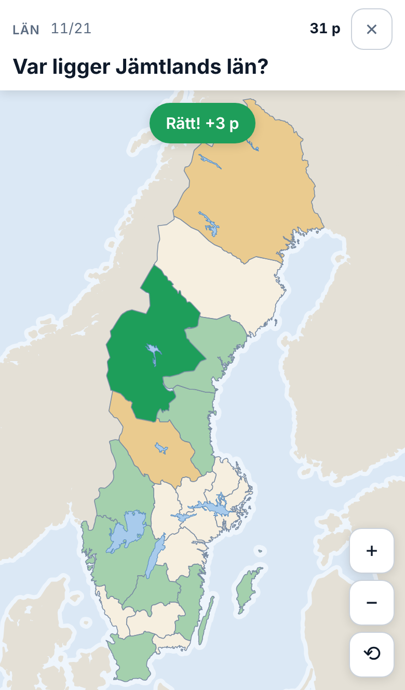

# Sverigespelet

Ett geografispel i webbläsaren om Sveriges 21 län, 25 landskap, 290 kommuner, residensstäder, 75 andra städer och tio största sjöar. Klicka rätt på kartan, samla poäng och ta dig in på topplistan – fungerar lika bra på mobilen som på datorn.



## Spela

Spelet finns på **https://sverigespelet.hamiltoon.workers.dev**

Källkod: [github.com/hamiltoon/sweden-county-quiz](https://github.com/hamiltoon/sweden-county-quiz)

Det är en PWA, så det går att lägga till på hemskärmen och spela offline.

## Språk

Spelet finns på svenska och engelska; byt med knapparna överst på startskärmen. Första gången väljs svenska om webbläsaren är inställd på svenska, annars engelska. Valet sparas på enheten, och för den som loggat in med passkey också på kontot, så att det följer med till andra enheter (efter inloggning gäller kontots språk). Ortnamnen är desamma på båda språken; länen heter t.ex. "Stockholm County" på engelska och Lappland "Lapland".

Alla texter finns i `src/i18n/sv.ts` och `src/i18n/en.ts` (samma nycklar, kontrolleras av TypeScript). Spelet sätter en cookie `lang` som API:t läser, så att även felmeddelandena från servern kommer på rätt språk (`worker/messages.ts`).

## Spellägen och poäng

- **Län** – klicka på rätt län.
- **Landskap** – klicka på rätt landskap, alla 25.
- **Kommuner** – 20 slumpade av Sveriges 290 kommuner. Klickar man på fel kommun säger spelet hur många kommuner bort den var, räknat i gränser (öar kopplas till närmaste kommun på fastlandet). Frågan säger vilket län kommunen ligger i ("Var ligger Bjurholms kommun i Västerbottens län?"), och kartan zoomar mjukt in från vyn man har så att länet fyller den (direkt med "minska rörelse"); länsgränserna är tjockare. Man kan zooma vidare själv, ända till ×40, så att också de minsta kommunerna, som Sundbyberg, Solna och Öckerö, går att träffa. I live laddas kommunkartan redan i lobbyn.
  Ett tryck på en kommun som är för liten för fingret (under 28 px på skärmen) räknas inte som svar; kartan förstoras i stället runt trycket, och nästa tryck räknas. De tre första gångerna på en enhet förklarar spelet det ("Liten kommun – förstorat, tryck igen"). Utanför länet är kartan nedtonad.
- **Residensstad** – klicka där staden ligger (inom 30 km, `cityRadiusKm` i `src/game/config.ts`).
- **Fler städer** – 20 slumpade av Sveriges 75 största städer som inte är residensstäder. Ett klick inom 30 km från staden ger poäng, precis som för residensstäderna.
- **Sjöar** – klicka på rätt sjö bland Sveriges tio största. Vid en miss på land visas hur långt bort klicket var.
- **Blandat** – slumpar mellan län- och stadsfrågor.

En omgång går igenom alla 21 län (alla 25 landskap, alla tio sjöar, eller 20 av kommunerna eller de andra städerna) i slumpad ordning. Rätt på första, andra eller tredje försöket ger 3, 2 respektive 1 poäng; därefter visas rätt svar och frågan ger 0 poäng (max 63 poäng per omgång, 75 för Landskap, 60 för Kommuner och Fler städer, 30 i sjöläget).

Under omgången fylls kartan: grönt för rätt direkt, gult för rätt efter fler försök och rött för missade. Det gör de sista frågorna lättare genom uteslutning; stäng av med `fillMapDuringRound` i `src/game/config.ts`. Vid en missad fråga zoomar kartan så att det sista felklicket och rätt svar syns tillsammans. Rätt svar får sitt namn på kartan, och en streckad linje med avståndet går från felklicket. Knappen "Nästa" räknar ned från 4 s. Ett tryck på kartan går vidare, och nedräkningen står still medan man håller fingret där. Slutskärmen visar poängen i en ring och en minikarta över hur varje fråga gick.

I de andra lägena finns sjöarna kvar på kartan som riktmärken, utan namn. Klicken går igenom sjöarna till länen under. Poängfunktionen är utbytbar (`defaultScoring` i `src/game/config.ts`). Bästa resultat per läge sparas också i `localStorage` och visas på startskärmen.

## Live

**Spela live** på startskärmen: tävla mot kompisar i realtid. Den som skapar ett rum får en kod på fyra tecken (t.ex. `KXR4`), en länk, `/live/KXR4`, att dela, och en QR-kod med samma länk som kompisarna kan skanna med mobilkameran; de andra går med via länken, QR-koden eller koden. QR-koden ritas i telefonen med [qrcode-generator](https://github.com/kazuhikoarase/qrcode-generator) (MIT), så ingen tjänst på nätet ser länken. Värden startar matchen.

- **Matchen:** värden väljer läge i lobbyn – alla spelets lägen finns: län, landskap, kommuner, residensstäder, fler städer, sjöar och blandat. I Blandat väljer värden vilka av dem som ska blandas (minst en; från början län och residensstäder), och kartan byts mellan frågorna efter vad som behövs. 10 slumpade frågor; alla får samma fråga samtidigt, med 12 sekunder och ett klick var. Städerna är rätt inom 30 km. Rätt svar ger 5–10 poäng: 10 för ett svar direkt, färre ju längre man väntar. Frågan avslutas när alla har svarat eller tiden är ute.
- **Efter varje fråga** visas rätt svar, allas klick som prickar med namn (✓ för rätt, ✗ för fel; den egna med kraftigare kant), den snabbaste med rätt svar ("⚡ Snabbast: Anna 1,4 s") och ställningen med poängen för frågan och den egna svarstiden; med fler än fem spelare visas topp 3, den egna raden och hur många fler det finns (alla syns på pallen). Svarstiden mäts på servern, från att frågan startar till att svaret kommer fram. Namnet på rätt svar (staden eller sjön) ritas överst, så att det går att läsa även när många har klickat runt det. Kartan zoomar så att rätt svar och allas prickar syns samtidigt, och avslöjandet visas i 5 sekunder, eller 7 sekunder med fyra spelare eller fler. Efter sista frågan visas en pallplats, och värden kan starta en ny match.
- **Servern bestämmer:** frågorna, tiden och poängen räknas på servern, så klockan i telefonen spelar ingen roll.
- **Tappad uppkoppling:** spelet ansluter igen av sig självt, och en omladdning går rakt tillbaka in i rummet. Lämnar värden tar nästa spelare över.
- Upp till 12 spelare per rum. Namnet behöver inte vara skyddat, och live-resultat räknas inte på topplistan. Ett rum som inte används på två timmar töms.

Varje rum är ett [Durable Object](https://developers.cloudflare.com/durable-objects/) (`LiveRoom` i `worker/live.ts`) som spelarna är anslutna till med WebSocket. Rummet använder WebSocket-hibernering och alarm, så det kostar inget medan ingen gör något.

- `POST /api/live` – skapa ett rum, svarar `{ code }` (begränsat per IP-adress).
- `GET /api/live/:kod/ws?player=<id>&name=<namn>` – WebSocket in i rummet. Meddelandena finns i `src/shared/live.ts`.

## Topplista

Skriv ett namn (på startskärmen eller efter en omgång) så sparas varje avslutad omgång på topplistan. Topplistan visar varje spelares bästa resultat per läge, topp 10. Fliken **Totalt** summerar varje spelares bästa resultat i alla sju lägena (max 414 poäng). Lika poäng ger delad placering, och den som kom dit först står överst.

- **Tidigare resultat:** första gången man väljer namn laddas webbläsarens sparade rekord upp, ett per läge.
- **Offline:** resultat som inte går att skicka läggs i en kö i `localStorage` och skickas nästa gång startskärmen visas. Varje resultat har ett eget id, så ett omförsök sparar aldrig dubbelt.
- **Rimlighetskontroll:** servern godtar bara poäng som går att få i läget och som stämmer med andelen rätt. Den kan inte bevisa att en omgång faktiskt spelats, så topplistan bygger på förtroende.
- **Integritet:** namnet visas öppet för alla. IP-adressen används bara för att begränsa antalet sparningar (20 per minut) och sparas inte.

### Skydda namnet med passkey

Vem som helst kan spela med ett namn utan konto. Den som vill kan skydda sitt namn med en passkey (Face ID, Touch ID, skärmlåset eller en säkerhetsnyckel): då kan bara den som är inloggad spara resultat under namnet, och samma passkey loggar in på andra enheter (passkeys synkas via iCloud-nyckelringen eller Googles lösenordshanterare).

- Inga lösenord, ingen e-post. Servern sparar bara passkeyns publika nyckel.
- Inloggningen är en slumpad token i en `HttpOnly`-, `Secure`-, `SameSite=Strict`-cookie som gäller i 180 dagar; databasen har bara en hash av den. Spelets JavaScript kan inte läsa den.
- Ett skyddat namn kan inte tas av någon annan. Försöker någon spara under det utan att vara inloggad avvisas resultatet, och det ligger kvar i kön tills hen loggar in eller byter namn.
- POST-anrop från andra webbplatser avvisas (kontroll av `Origin`), så inloggningen kan inte missbrukas via någon annans sida.
- WebAuthn sköts av [SimpleWebAuthn](https://simplewebauthn.dev/) (`@simplewebauthn/server` i Workern, `@simplewebauthn/browser` i spelet). Relying Party är värdnamnet sidan körs på, så det fungerar både lokalt (`http://localhost:8787`) och i produktion.

## Kör lokalt

```sh
npm install
npm run dev          # Vite dev-server med hot reload
npm run build        # bygger till dist/
npm run preview:cf   # bygger, skapar lokal D1-databas och kör wrangler dev med API:t, som på Cloudflare
```

Topplistan behöver API:t, så den fungerar i `npm run preview:cf` men inte i `npm run dev`.

`npm run typecheck` kör `tsc` för både spelet och Worker-scriptet.

## Deploya

Varje ändring går först till staging, sedan till produktion:

1. **Staging:** `npm run deploy:staging` bygger, kör nya migreringar och deployar till
   <https://sverigespelet-staging.hamiltoon.workers.dev>. Staging är en egen Worker (`env.staging` i
   `wrangler.jsonc`) med egen D1-databas (`sverigespelet-staging`), egna live-rum och egen rate limiting;
   inget delas med produktionens topplista eller konton. Staging visar en randig banderoll överst,
   "STAGING – testmiljö, inte den riktiga topplistan", och "[Staging]" i sidans titel
   (`VITE_ENVIRONMENT=staging` vid bygget, se `src/environment.ts`).
2. **Acceptanstester:** `npm run test:e2e` (se nedan) mot staging.
3. **UX-granskning** på staging.
4. **Produktion:** när testerna gått igenom och UX har godkänt.

```sh
npx wrangler login           # en gång
npm run deploy:staging       # bygg, migrera och deploya till staging
npm run test:e2e             # acceptanstesterna mot staging
npm run db:migrate:remote    # när det finns nya filer i migrations/
npm run deploy               # produktion: npm run build && wrangler deploy
```

### Acceptanstester

`npm run test:e2e` kör [Playwright](https://playwright.dev) mot staging, eller mot en annan adress:
`npm run test:e2e -- http://localhost:8787/`. Kräver Playwright med Chromium (`npm i -D playwright && npx playwright install chromium`, eller en global installation) och Node 22.

- **start:** Spela live syns utan scroll på iPhone 13 och en Android på 360 × 740. På staging finns banderollen och "[Staging]" i titeln, på produktionen inte.
- **solo:** en hel omgång i vart och ett av de sju lägena, med rätt svar på varje fråga, fram till slutskärmen utan fel i sidan.
- **miss:** avslöjandet efter en missad fråga i solospelet (PO-15). Felklicket och rätt svar ska synas i samma vy, utanför rätt/fel-rutan. Rätt svar ska ha sitt namn på kartan, och en linje ska gå dit med avståndet, som inte får täcka namnet. Spelet ska gå vidare med "Nästa" eller efter minst 4 s. Nedräkningen ska stå still medan man håller på kartan, och för den som använt tangentbordet medan fokus är i rutan. Hinten om att hålla på kartan ska visas de tre första gångerna per enhet. Rätt på första försöket ska gå vidare efter 1,5 s som förut. Dessutom testas "minska rörelse", engelska och axe på rutan.
- **live:** en match med 2 spelare (iPhone och Android, mörkt läge, engelska) och en med 12 (en webbläsare och 11 bottar via WebSocket, Blandat med alla sorter). Starta matchen ska synas utan scroll i lobbyn. Vid varje avslöjande ska rätt svar och allas prickar ligga i vyn och inte under rätt/fel-rutan, och den egna raden i ställningen ska synas helt.
- **a11y:** rätt/fel-rutan har kontrast minst 4,5:1 och en ikon, axe-core (WCAG 2.2 AA och best practice) hittar inget av nivån serious eller critical på start-, spel-, slut- eller lobbyskärmen (fynd på lägre nivå skrivs ut som kända), och kartan och minikartan skiljer rätt direkt, fler försök och missat åt även med simulerad deuteranopi och protanopi (i ljust och mörkt läge).
- **guard:** skyddsräcket nedan fungerar.

Testerna körs samtidigt och tar ungefär en och en halv minut. Skärmbilder från varje steg hamnar i
`e2e-results/<tid>/`. `--only=solo,live` kör bara vissa tester, `--verbose` skriver ut alla kontroller. Före testerna väntar sviten (upp till tre minuter) på att servern serverar samma bygge
som ligger i `dist/`, så att en körning direkt efter en deploy inte testar en blandning av gammalt och
nytt; `--any-build` hoppar över det.

Utom mot staging och localhost stoppas alla anrop som skulle skriva på topplistan, skapa passkeys
eller ändra ett kontos språk redan i webbläsaren (`e2e/lib.mjs`). Skyddet är alltså på mot
produktionen och mot alla adresser testerna inte känner till, och testerna anger aldrig något namn.
Live-rum går bra att skapa var som helst; de töms av sig själva.

Sajten deployas till Cloudflare Workers. `wrangler.jsonc` pekar ut `dist/` som static assets med `not_found_handling: "single-page-application"` (SPA-fallback till `index.html`). Bara `/api/*` går till Worker-scriptet i `worker/index.ts` (`run_worker_first`); allt annat serveras direkt som filer.

Topplistan och kontona ligger i D1-databasen `sverigespelet` (tabellerna `scores`, `players`, `passkeys`, `sessions` och `auth_challenges`, se `migrations/`). Antalet sparningar per IP-adress begränsas med Workers rate limiting (`SUBMIT_LIMITER`). Kör `npx wrangler types worker/worker-configuration.d.ts` efter ändringar i `wrangler.jsonc`.

API:

- `GET /api/scores?mode=lan&limit=10` – bästa resultat per spelare i ett läge (`lan`, `stad`, `sjo`, `blandat`), eller `mode=total` för summan av varje spelares bästa resultat i alla lägen.
- `POST /api/scores` med `{ "name": "...", "results": [{ "id", "mode", "score", "percent", "playedAt" }] }` – sparar upp till tio resultat och svarar med spelarens placering per läge och totalt. Inloggad spelare sparar alltid under kontots namn.
- `GET /api/me` – inloggad spelare och kontots språk (`{ "name": null, "language": null }` om ingen).
- `POST /api/passkey/register/options` och `.../register/verify` – skydda ett namn med en ny passkey (eller lägg till en passkey till det egna kontot).
- `POST /api/passkey/login/options` och `.../login/verify` – logga in med en befintlig passkey.
- `POST /api/logout` – logga ut den här enheten.
- `POST /api/me/language` – spara språket (`sv` eller `en`) på kontot, om enheten är inloggad.

## Kartdata

`public/data/lan.topo.json` (ca 65 kB TopoJSON, WGS84) innehåller Sveriges 21 län. Den är byggd från Natural Earth 1:10m *Admin 1 – States, Provinces* ([naturalearthdata.com](https://www.naturalearthdata.com/), [nvkelso/natural-earth-vector](https://github.com/nvkelso/natural-earth-vector)), filtrerad på Sverige, med länskod från ISO 3166-2 och namn satta till de officiella länsnamnen.

`public/data/sjoar.topo.json` (ca 19 kB) innehåller Sveriges tio största sjöar från Natural Earth 1:10m *Lakes + Reservoirs*. Vilka sjöar som är störst, och i vilken ordning, följer SMHI:s sjöregister ([lista på Wikipedia](https://sv.wikipedia.org/wiki/Lista_%C3%B6ver_Sveriges_st%C3%B6rsta_sj%C3%B6ar)), inte ytan i Natural Earths förenklade geometri. Listan finns i `src/data/lakes.ts`.

`public/data/grannar.topo.json` (ca 57 kB) innehåller grannländerna runt Östersjön som bakgrund, från Natural Earth 1:10m *Admin 0 – Countries*, klippta till området runt Sverige och förenklade.

Natural Earth är public domain – ingen attribution krävs, men spelet länkar till källan i sidfoten. *Made with Natural Earth.*

`public/data/landskap.topo.json` (ca 70 kB) innehåller Sveriges 25 landskap, byggda från [OpenStreetMap](https://www.openstreetmap.org/) (© OpenStreetMap-bidragsgivare, [ODbL](https://www.openstreetmap.org/copyright)) och klippta mot länskartans kust. 15 landskap finns som egna gränser i OSM. Öland och Härjedalen byggs av sina kommuner, Skåne, Blekinge, Halland, Gotland, Värmland, Dalarna och Jämtland av sina län, och Lappland är det som blir kvar av Norrbottens och Västerbottens län. Glipor mellan källorna går till det landskap som delar längst gräns med dem, så gränserna är på sina ställen ungefärliga. Bygg om med `./scripts/build-landskap.sh` (hämtar från OSM:s API; kräver python3 och npm). Detaljerna står i `scripts/landskap/compose.py`.

`public/data/kommuner.topo.json` (ca 260 kB, 90 kB komprimerat) innehåller Sveriges 290 kommuner, byggda från [OpenStreetMap](https://www.openstreetmap.org/) (© OpenStreetMap-bidragsgivare, [ODbL](https://www.openstreetmap.org/copyright)) och klippta mot länskartans kust, kompletterad med de små öarna ur Natural Earths *Minor Islands* (annars får skärgårdskommuner som Öckerö ingen yta). Vilka kommuner som finns, och deras koder, kommer från SCB; svenska och engelska namn och OSM-relation från Wikidata (`scripts/kommuner/kommuner.json`). Varje gräns kontrolleras mot kommunkoden i OSM. Kartan laddas först när man spelar läget. Bygg om med `./scripts/build-kommuner.sh` (hämtar ca 90 MB från OSM:s API och skriver också `src/data/municipalities.ts`).

Bygg om kartdatan (laddar ner källfilerna, ca 60 MB, och kör mapshaper via `npx`):

```sh
./scripts/build-geodata.sh [ne_10m_admin_1_states_provinces.geojson] [ne_10m_lakes.geojson] [ne_10m_admin_0_countries.geojson]
```

Residensstädernas koordinater ligger i `src/data/counties.ts`.

De 75 andra städerna ligger i `src/data/cities.ts`. Urvalet är de största tätorterna enligt SCB 2023 (folkmängd per tätort, tabell MI0810), utom residensstäderna, förorter till Stockholm, Göteborg och Malmö samt bostadsorterna Märsta, Skoghall och Onsala; urvalsregeln står i filen. Koordinaterna kommer från Wikidata och är kontrollerade mot rätt län på kartan.

Ikonerna i `public/icons/` renderas från `icon.svg` med `node scripts/make-icons.mjs` (kräver [Playwright](https://playwright.dev/) med Chromium; sätt `PLAYWRIGHT_PKG` om paketet inte finns lokalt).

## Kodstruktur

Vite + TypeScript utan ramverk (vanilla DOM). Kartan ritas som SVG med [d3-geo](https://github.com/d3/d3-geo) (transversal Mercator), [d3-zoom](https://github.com/d3/d3-zoom) för pinch-zoom/panorering och [topojson-client](https://github.com/topojson/topojson-client).

- `src/main.ts` – startar appen och kopplar ihop spel, karta och UI.
- `src/data/` – länen med koder, namn, residensstäder och koordinater, landskapen, kommunerna, de andra städerna och de största sjöarna.
- `src/game/` – spellogik: frågor, försök, poäng (`config.ts`), avståndsberäkning och lagring av rekord, namn och osända resultat.
- `src/shared/` – topplistans och live-lägets regler och typer, delade av spelet och Worker-scriptet.
- `src/api/` – klienten för topplistans API, med kö för osända resultat, och för kontona (passkeys).
- `src/map/` – SVG-kartan: projektion, zoom, klick, markeringar, sjöar, grannländer och minikartor.
- `src/i18n/` – språken: alla texter på svenska och engelska, och valet av språk.
- `src/live/` – live-läget: anslutningen till rummet och skärmarna (lobby, frågor, ställning, pall).
- `src/ui/` – start- och resultatskärm, topplista, DOM-hjälpare, toast.
- `src/pwa.ts` – registrerar service workern i produktion.
- `src/style.css` – stilar, mobile first, dark mode via `prefers-color-scheme`.
- `public/` – kartdata, ikoner och `manifest.webmanifest`.
- `scripts/` – bygger kartdata och ikoner.
- `vite.config.ts` – Vite-konfig med ett litet plugin som genererar `sw.js` (precachar appen och kartdatan; API:t går alltid till nätet).
- `worker/` – Worker-scriptet för `/api/*`: topplistan (`index.ts`), konton med passkeys (`auth.ts`), live-rummen (`live.ts`), hjälpare och genererade typer.
- `migrations/` – databasschemat för D1.
- `e2e/` – acceptanstesterna (`npm run test:e2e`).
- `wrangler.jsonc` – Cloudflare Workers-konfig: static assets, D1, Durable Objects och rate limiting, och staging-miljön.

## Licens

MIT, se [LICENSE](LICENSE). © John Mårtensson.

Kartdata från [Natural Earth](https://www.naturalearthdata.com/), public domain. Landskaps- och kommungränserna © [OpenStreetMap](https://www.openstreetmap.org/copyright)-bidragsgivare, ODbL.
